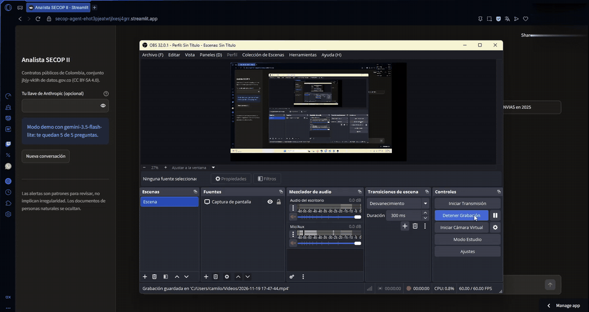
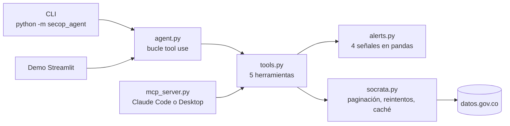

<!--
  ### Archivo: README.md ###
  Autor: Juan Camilo Agudelo (Jagudelo14)
  Correo: camiloagu1401@gmail.com
  Fecha: 2026-11-16 (actualizado 2026-11-19)
  Descripción: Presentación, instalación y métricas del agente SECOP II
-->

# Agente analista de contratación pública (SECOP II)

**Pregúntale en español a los contratos públicos de Colombia y recibe cifras verificables: cada número trae el enlace al contrato del que salió.**

[](https://secop-agent-ehot3pjeatwtjlxesj4grr.streamlit.app)


**[▶ Probar la demo](https://secop-agent-ehot3pjeatwtjlxesj4grr.streamlit.app)** · [Cómo se evaluó](docs/evaluacion-definitiva.md) · [Arquitectura](#arquitectura)



*En tiempo real y sin cortes: la respuesta tardó 4,7 s y el enlace abre el contrato en SECOP. Según la consulta, puede tardar de unos segundos a más de un minuto, sobre todo por datos.gov.co.*

## Resultados

Lo evalué con **50 preguntas diferentes a las del desarrollo**, con las respuestas correctas recalculadas en vivo contra datos.gov.co.

| | Resultado |
| --- | --- |
| Acierto a ciegas (agente v7) | **74%** (37/50) |
| Acierto después de corregir los fallos encontrados (v9) | **86%** (43/50) |
| Enlaces inventados | **0** de 652 en la v9 (0 de 453 en la v7) |
| Preguntas fuera de alcance que declinó en vez de inventar | **5/5** |
| Costo por pregunta | USD 0 con Gemini gratis · ~USD 0,004 con Claude Haiku |

El 74% es el número oficial. El 86% se logró mirando los fallos de ese mismo set, así que se reporta aparte ([detalle](#evaluación)).

## Qué hace

- **Responde en lenguaje natural** conteos, sumas, rankings y listados, filtrando por entidad, año, modalidad, tipo de contrato, valor, duración, lugar o palabras del objeto.
- **Entiende datos sucios de verdad.** Una misma gobernación aparece en SECOP con decenas de nombres ("DEPARTAMENTO DE…", "GOBERNACIÓN…", con doble espacio). El agente la arma completa con sus dependencias, deja por fuera contralorías y ESE, y avisa cuando hay municipios homónimos.
- **Marca patrones para revisar** con 4 reglas deterministas: posible fraccionamiento, concentración en contratación directa, fechas inconsistentes y valores atípicos. Siempre con el aviso *"patrón para revisar, no implica irregularidad"*.
- **No inventa.** Las cifras las calcula el código, no el modelo. Si la respuesta trae un número que no salió de una herramienta, el agente la corrige, y si la pregunta pide algo que SECOP no tiene (calidad de obras, sanciones), lo dice.
- **Se usa de tres formas:** demo web, línea de comandos y servidor MCP para Claude Code o Claude Desktop.

## Stack técnico

| Capa | Tecnología |
| --- | --- |
| Agente | Bucle de *tool use* escrito a mano, sin LangChain. Funciona con **Claude** (SDK `anthropic`) o **Gemini** (`google-genai`) cambiando una variable |
| Datos | API **Socrata/SoQL** de datos.gov.co (SECOP II): agregaciones en el servidor, paginación, reintentos y caché en disco |
| Análisis | **pandas** para las señales de alerta |
| Integración | Servidor **MCP** (SDK oficial `mcp`) con las mismas 5 herramientas del agente |
| Interfaz | **Streamlit** en Community Cloud, con límite de preguntas y cédulas ocultas |
| Calidad | **pytest** (85 pruebas sin red) y un *harness* de evaluación propio con calificación automática y manual |
| Entorno | Python 3.12 y **uv** |

## Arranque en cinco minutos

```bash
pip install uv
git clone https://github.com/Jagudelo14/secop-agent.git && cd secop-agent
uv sync --extra demo
cp .env.example .env        # gratis: PROVEEDOR=gemini y GEMINI_API_KEY; o PROVEEDOR=anthropic y ANTHROPIC_API_KEY

uv run python -m secop_agent "¿Cuántos contratos firmó la Gobernación del Cauca en 2025?" --traza
uv run streamlit run app/streamlit_app.py
uv run pytest
```

## Arquitectura



El agente solo decide qué consultar y redacta la respuesta. Los montos, rankings y alertas los calcula el código, y `tools.py` es la única fuente de herramientas: el agente y el MCP importan las mismas funciones y las mismas descripciones.

| Herramienta | Qué hace |
| --- | --- |
| `buscar_entidad(nombre)` | Candidatas con `codigo_entidad` y NIT, sin importar tildes; arma la gobernación o alcaldía completa con sus dependencias y avisa de municipios homónimos |
| `consultar_contratos(filtros)` | Lista contratos (máximo 5.000) con el conteo y la suma reales |
| `agregar(filtros, agrupar_por, metrica)` | Rankings y totales agrupados en el servidor con `$group`, por contratista, entidad, ciudad, departamento, sector, año, modalidad o tipo |
| `detectar_alertas(codigo_entidad, anio)` | Las 4 señales con los contratos que las generan |
| `detalle_contrato(id_contrato)` | Un contrato con su enlace a SECOP |

Los filtros son los mismos en todas: entidad (una, varias, por inicio o por parte del nombre), año o rango de años, palabras en el objeto (alguna o todas), tipo de contratista (natural o jurídica), duración y valor con límite incluido o estricto, modalidad, tipo de contrato y lugar.

## Lo que salió del esquema real (fase 0)

Antes de escribir una sola herramienta, revisé cómo es de verdad el conjunto de SECOP II en datos.gov.co. `scripts/fase0_esquema.py` baja los metadatos y una muestra de 1.000 contratos y genera [docs/schema.json](docs/schema.json) y [docs/esquema.md](docs/esquema.md). El conjunto tiene 95 columnas; el agente usa 20. Lo que encontré y cómo cambió el diseño:

- **El NIT no identifica una entidad.** Las secretarías de Bogotá comparten el NIT del Distrito, y el mismo NIT aparece con y sin dígito de verificación (`899999061` y `8999990619`). Si se filtra por NIT, se mezclan entidades distintas. Por eso todo se filtra y agrupa por `codigo_entidad`, que sí es único, y `buscar_entidad` existe para traducir un nombre a ese código.
- **Los montos llegan como texto, pero en el servidor son números.** En el JSON `valor_del_contrato` viene como `"10007333"`, mientras que Socrata lo guarda como `number`. Eso permite sumar, contar y agrupar en el servidor con `$group` en vez de bajar miles de filas: un ranking de toda una entidad es una sola consulta.
- **El enlace al contrato viene anidado.** `urlproceso` llega como objeto `{"url": ...}`, no como texto. Es el enlace que acompaña cada cifra, así que se extrae siempre de ahí y el modelo nunca lo escribe.
- **Faltan datos en columnas clave.** El 0,5% de los contratos no tiene `fecha_de_firma`: quedan por fuera de cualquier filtro por año, porque el año sale de esa fecha, y al ordenar por fecha `DESC` sin filtro de año salen primero. El 21% no tiene `ciudad` ("No Definido"), y en los rankings por ubicación ese grupo se reporta aparte en vez de aparecer como si fuera un municipio.
- **Hay contratos que no cuentan.** Los estados "Borrador" y "Cancelado" no son contratos firmados, así que todas las consultas los excluyen.
- **Ignorar tildes con comodines mezcla lugares.** Para que "Bogota" encontrara "Bogotá" se usaban comodines en las vocales, pero "Cauca" terminaba atrapando "Chocó". Los departamentos y ciudades se resuelven contra la lista real de valores y se filtran con `=`.
- **Algunas columnas son listas cerradas.** `tipo_de_contrato` y `modalidad_de_contratacion` tienen un conjunto fijo de valores, así que se validan como `enum` y el modelo no puede inventar una modalidad que no existe.
- **Hay datos personales.** `documento_proveedor` trae la cédula de las personas naturales. La demo pública la oculta.

## Señales de alerta

Cuatro reglas deterministas en pandas ([alerts.py](src/secop_agent/alerts.py)). El LLM nunca decide si algo es una alerta, solo explica las que el código encontró. Cada hallazgo sale con el aviso *"patrón para revisar, no implica irregularidad"* y los enlaces a sus contratos.

| Señal | Regla | Parámetros |
| --- | --- | --- |
| Posible fraccionamiento | Misma entidad y proveedor, 3+ contratos en la ventana, cada uno bajo el umbral y la suma por encima | `ventana_dias=30`, `umbral_fraccionamiento=50.000.000` |
| Concentración en contratación directa | Un proveedor recibe más del porcentaje del valor directo de la entidad en el año | `porcentaje_concentracion=0.20`, `monto_minimo_entidad=100.000.000` |
| Fechas inconsistentes | Fin antes del inicio, firma después del inicio o duración cero | — |
| Valor atípico | Valor sobre el percentil del mismo tipo y modalidad en la entidad | `percentil_atipico=99`, `min_grupo_atipico=20` |

## Evaluación

Hay dos sets, y no cumplen el mismo papel:

- **Desarrollo (30 preguntas)**, en [evals/preguntas.jsonl](evals/preguntas.jsonl): sirvió para mejorar el prompt de v1 a v7. Último resultado: **28/30**. Como se ajustó el agente mirando estas respuestas, el número es optimista. La historia está en [docs/prompt-versiones.md](docs/prompt-versiones.md).
- **Definitivo (50 preguntas)**, en [evals/preguntas_definitivas.jsonl](evals/preguntas_definitivas.jsonl): lo escribí yo y lo congelé con su huella SHA-256 antes de que el agente lo viera. Congelé el agente v7 y respondió una sola vez. Las preguntas que no tuvieron respuesta por caídas de Gemini o de datos.gov.co se repitieron, y se dice cuáles. El protocolo completo y cada decisión están en [docs/evaluacion-definitiva.md](docs/evaluacion-definitiva.md).

Las respuestas correctas son consultas SoQL escritas a mano y se recalculan al calificar, porque SECOP cambia todos los días. Conteo, ranking y filtro se califican automáticamente. Las ambiguas y las fuera de alcance se califican a mano, con la razón escrita en [evals/resultados/20261118-085949-manual.json](evals/resultados/20261118-085949-manual.json).

### Resultado final (corrida `20261118-085949`, Gemini 3.5 Flash-Lite)

| Tipo | Acierto |
| --- | --- |
| Conteo o suma | 13/15 (87%) |
| Ranking | 12/15 (80%) |
| Filtro | 3/10 (30%) |
| Ambigua | 4/5 (80%) |
| Fuera de alcance | 5/5 (100%) |
| **Total** | **37/50 (74%)** |

| Métrica | Valor |
| --- | --- |
| Enlaces inventados (no vienen de ninguna herramienta) | 0/453 |
| Preguntas sin respuesta | 0/50 |
| Herramientas por pregunta | 2,7 en promedio |
| Latencia | 135 s promedio, 87 s mediana, 343 s p95 (la domina datos.gov.co) |
| Tokens por pregunta | 33.515 de entrada y 1.296 de salida en promedio |
| Costo | USD 0 con la cuota gratuita de Gemini. Con los mismos tokens: USD 0,004 por pregunta en Claude Haiku 5.5 y USD 0,08 en Claude Sonnet 5.5 |

No se llegó a la meta del SPEC (80%). La causa más frecuente de los 13 fallos es la resolución de entidades: SECOP registra una misma gobernación o alcaldía con nombres distintos (otro prefijo, doble espacio) y el filtro por inicio de nombre deja dependencias por fuera. Le siguen los filtros por texto, en los que el agente elige palabras clave distintas a las que definen la respuesta correcta, y dos errores por tomar "superior a" como "mayor o igual". Cuando falla, falla en cómo arma la consulta, no en inventar: no hay enlaces inventados y declinó bien las 5 preguntas fuera de alcance. El análisis de los 13 fallos está en [docs/evaluacion-definitiva.md](docs/evaluacion-definitiva.md#errores-13).

### Después de la evaluación: v8 y v9

Con esos fallos a la vista se hicieron dos versiones más. No reemplazan al 74%: se ajustaron mirando las respuestas de este mismo set, así que miden cuánto mejora el agente al corregir fallos conocidos, no cómo le va con preguntas nuevas.

| Versión | Acierto | Conteo | Ranking | Filtro | Ambigua | Fuera de alcance | Enlaces inventados |
| --- | --- | --- | --- | --- | --- | --- | --- |
| v7, a ciegas (oficial) | 37/50 (74%) | 13/15 | 12/15 | 3/10 | 4/5 | 5/5 | 0/453 |
| v8 | 39/50 (78%) | 11/15 | 15/15 | 5/10 | 3/5 | 5/5 | 2/425 |
| v9 (la actual) | 43/50 (86%) | 14/15 | 15/15 | 5/10 | 4/5 | 5/5 | 0/652 |

La mejora principal es que `buscar_entidad` ahora arma la gobernación o alcaldía completa, con las dependencias registradas con otro nombre, y deja por fuera las entidades autónomas (contralorías, ESE) que tienen el lugar en el nombre. También se agregaron filtros estrictos para "superior a" y búsqueda con todas las palabras en el objeto. Los 7 fallos que quedan y el detalle de cada cambio están en [docs/evaluacion-definitiva.md](docs/evaluacion-definitiva.md#después-de-la-evaluación-v8-y-v9-no-son-medición-a-ciegas).

```bash
uv run python evals/run.py --validar                                   # revisa las consultas, sin gastar LLM
uv run python evals/run.py                                             # set de desarrollo
uv run python evals/run.py --preguntas evals/preguntas_definitivas.jsonl
uv run python evals/run.py --verificar evals/resultados/<corrida>.jsonl  # solo recalifica
```

## Servidor MCP

El servidor publica las cinco herramientas con el mismo esquema y la misma descripción que ve el agente, y una prueba ([tests/test_mcp_server.py](tests/test_mcp_server.py)) verifica que no se desincronicen. Corre en local por stdio, así que funciona con clientes que se instalan en el equipo. Claude en la web (claude.ai) no puede usarlo tal cual, porque solo se conecta a servidores MCP publicados con una URL `https://`.

### Claude Code

```bash
claude mcp add -s user secop-ii -- uv --directory "C:/ruta/a/secop-agent" run secop-mcp
claude mcp list   # debe decir secop-ii ... Connected
```

`-s user` lo deja disponible en cualquier carpeta; sin esa opción solo aparece en la carpeta donde se corrió el comando. Después hay que abrir una conversación nueva (en VS Code, recargar la ventana) y revisar con `/mcp` que esté conectado. Cuando se usa, las llamadas aparecen como `secop-ii [buscar_entidad]`, `secop-ii [agregar]`, etc.

Con la extensión de VS Code el comando `claude` no queda en la terminal. El ejecutable está dentro de la extensión, en `%USERPROFILE%\.vscode\extensions\anthropic.claude-code-<versión>\resources\native-binary\claude.exe`.

### Claude Desktop

En Settings → Developer → Edit Config, dentro de `claude_desktop_config.json`:

```json
{
  "mcpServers": {
    "secop-ii": {
      "command": "uv",
      "args": ["--directory", "C:/ruta/a/secop-agent", "run", "secop-mcp"]
    }
  }
}
```

Si el cliente no encuentra `uv`, se pone la ruta completa del ejecutable (en Windows, por ejemplo, `C:/Users/<usuario>/AppData/Local/Programs/Python/Python313/Scripts/uv.exe`). Hay que cerrar Claude Desktop por completo y volver a abrirlo; el servidor aparece en Settings → Developer.

## Modelos y costo

El agente funciona con dos proveedores, elegidos con `PROVEEDOR`:

- **`anthropic`:** Claude Sonnet 5.5 por defecto y Claude Haiku 5.5 como opción barata, con la variable `MODEL`. Con Sonnet se activa el *fallback* del servidor (`fallbacks: "default"`) por si el modelo rechaza una petición. El prompt de sistema y las herramientas van en caché.
- **`gemini`:** Gemini 3.5 Flash-Lite en la cuota gratuita, con Gemini 3.1 Flash-Lite de respaldo cuando el principal está saturado. Con este proveedor se hizo la evaluación final.

En los dos casos el bucle está escrito a mano y el máximo es de 8 llamadas a herramientas por pregunta.

## Demo pública

**En línea:** https://secop-agent-ehot3pjeatwtjlxesj4grr.streamlit.app

La demo de Streamlit usa el proveedor configurado (Gemini en la cuota gratuita, el mismo de la evaluación) con un límite de 5 preguntas por sesión, o Claude Sonnet sin límite si el visitante pega su propia llave de Anthropic. Oculta la cédula de las personas naturales. Para Streamlit Community Cloud, los *secrets* van como en [.streamlit/secrets.toml.example](.streamlit/secrets.toml.example): `PROVEEDOR`, `GEMINI_API_KEY`, `MODELGEMINI` y `GEMINI_RESPALDO` (o `ANTHROPIC_API_KEY` si la demo usa Claude). La app los pasa a variables de entorno al arrancar. Si datos.gov.co está caído, `SECOP_MODO_DEMO=1` responde solo desde la caché en disco.

## Estructura

```
secop-agent/
├── src/secop_agent/
│   ├── socrata.py        # cliente API: paginación, reintentos, caché
│   ├── schema.py         # columnas reales, normalización, validación, SoQL
│   ├── tools.py          # herramientas que ven el agente y el MCP
│   ├── alerts.py         # las 4 señales, sin LLM
│   ├── agent.py          # bucle del agente con tool use (Claude)
│   ├── agent_gemini.py   # el mismo bucle con Gemini
│   ├── mcp_server.py     # mismas herramientas por MCP
│   └── __main__.py       # CLI
├── app/streamlit_app.py
├── scripts/fase0_esquema.py
├── evals/preguntas.jsonl             # set de desarrollo (30)
├── evals/preguntas_definitivas.jsonl # set definitivo (50)
├── evals/run.py
├── evals/resultados/                 # corridas, métricas y calificación manual
├── tests/                # sin red, con respuestas grabadas
└── docs/                 # esquema, versiones del prompt y evaluación definitiva
```

## Datos

[SECOP II – Contratos Electrónicos](https://www.datos.gov.co/d/jbjy-vk9h), Colombia Compra Eficiente, licencia CC BY-SA 4.0.
