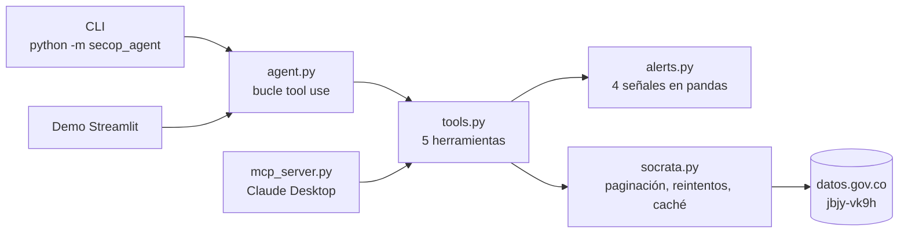

<!--
  ### Archivo: README.md ###
  Autor: Juan Camilo Agudelo (Jagudelo14)
  Correo: camiloagu1401@gmail.com
  Fecha: 2026-11-16 (actualizado 2026-11-19)
  Descripción: Presentación, instalación y métricas del agente SECOP II
-->

# Agente analista de contratación pública (SECOP II)

Un agente en Python que responde preguntas en lenguaje natural sobre contratos públicos colombianos y marca patrones que vale la pena revisar. Cada cifra que entrega trae el enlace al contrato del que salió.

> *¿Qué contratistas recibieron más dinero por contratación directa de la Secretaría General de la Alcaldía Mayor de Bogotá en 2025?*
> → tabla con el top, total en pesos, número de contratos y enlace a SECOP de cada uno.

Qué muestra este repo:

1. **Un agente con herramientas sobre una API real con datos sucios.** El bucle de *tool use* está escrito a mano con el SDK `anthropic`, sin LangChain ([agent.py](src/secop_agent/agent.py)).
2. **Un servidor MCP propio** que expone las mismas herramientas ([mcp_server.py](src/secop_agent/mcp_server.py)).
3. **Calidad medida** con un set de desarrollo de 30 preguntas y una evaluación final de 50 que el agente vio una sola vez, con respuestas correctas recalculadas en vivo ([evals/](evals/), [docs/evaluacion-definitiva.md](docs/evaluacion-definitiva.md)). **Resultado a ciegas: 37/50 (74%), 0 enlaces inventados de 453.** Después de corregir los fallos encontrados: 43/50 (86%).
4. **Se corre en cinco minutos**, o se prueba en la [demo en línea](https://secop-agent-ehot3pjeatwtjlxesj4grr.streamlit.app).

## Arranque en cinco minutos

```bash
pip install uv
git clone <repo> && cd secop-agent
uv sync --extra demo
cp .env.example .env        # gratis: PROVEEDOR=gemini y GEMINI_API_KEY; o PROVEEDOR=anthropic y ANTHROPIC_API_KEY

uv run python -m secop_agent "¿Cuántos contratos firmó la Gobernación del Cauca en 2025?" --traza
uv run streamlit run app/streamlit_app.py
uv run pytest
```

## Arquitectura



Claude solo decide qué consultar y redacta la respuesta. Los montos, rankings y alertas los calcula el código, y `tools.py` es la única fuente de herramientas: el agente y el MCP importan las mismas funciones y las mismas descripciones.

| Herramienta | Qué hace |
| --- | --- |
| `buscar_entidad(nombre)` | Candidatas con `codigo_entidad` y NIT, sin importar tildes; arma la gobernación o alcaldía completa con sus dependencias y avisa de municipios homónimos |
| `consultar_contratos(filtros)` | Lista contratos (máximo 5.000) con el conteo y la suma reales |
| `agregar(filtros, agrupar_por, metrica)` | Rankings y totales agrupados en el servidor con `$group`, por contratista, entidad, ciudad, departamento, sector, año, modalidad o tipo |
| `detectar_alertas(codigo_entidad, anio)` | Las 4 señales con los contratos que las generan |
| `detalle_contrato(id_contrato)` | Un contrato con su enlace a SECOP |

Los filtros son los mismos en todas: entidad (una, varias, por inicio o por parte del nombre), año o rango de años, palabras en el objeto (alguna o todas), tipo de contratista (natural o jurídica), duración y valor con límite incluido o estricto, modalidad, tipo de contrato y lugar.

## Lo que salió del esquema real (fase 0)

`scripts/fase0_esquema.py` baja los metadatos y 1.000 filas y genera [docs/schema.json](docs/schema.json) y [docs/esquema.md](docs/esquema.md). Todas las columnas esperadas existen. Lo que cambió el diseño:

- **El NIT no identifica una entidad.** Las secretarías de Bogotá comparten el NIT del Distrito, y el mismo NIT aparece con y sin dígito de verificación (`899999061` y `8999990619`). Se filtra y agrupa por `codigo_entidad`.
- `urlproceso` llega como objeto `{"url": ...}`, no como texto.
- Los montos son `number` en Socrata (se suman en el servidor) pero llegan como texto en el JSON.
- Hay contratos sin `fecha_de_firma`; ordenar por fecha `DESC` los pone primero.
- Comparar con comodines para ignorar tildes mezcla lugares ("Cauca" atrapaba "Chocó"). Departamentos y ciudades se resuelven contra la lista real de valores y se filtran con `=`.
- `tipo_de_contrato` y `modalidad_de_contratacion` son listas cerradas y se validan como `enum`.

## Señales de alerta

Cuatro reglas deterministas en pandas ([alerts.py](src/secop_agent/alerts.py)). El LLM nunca decide si algo es una alerta, solo explica las que el código encontró. Cada hallazgo sale con el aviso *"patrón para revisar, no implica irregularidad"* y los enlaces a sus contratos.

| Señal | Regla | Parámetros |
| --- | --- | --- |
| Posible fraccionamiento | Misma entidad y proveedor, 3+ contratos en la ventana, cada uno bajo el umbral y la suma por encima | `ventana_dias=30`, `umbral_fraccionamiento=50.000.000` |
| Concentración en contratación directa | Un proveedor recibe más del porcentaje del valor directo de la entidad en el año | `porcentaje_concentracion=0.20`, `monto_minimo_entidad=100.000.000` |
| Fechas inconsistentes | Fin antes del inicio, firma después del inicio o duración cero | — |
| Valor atípico | Valor sobre el percentil del mismo tipo y modalidad en la entidad | `percentil_atipico=99`, `min_grupo_atipico=20` |

## Evaluación

Hay dos sets, y no cumplen el mismo papel:

- **Desarrollo (30 preguntas)**, en [evals/preguntas.jsonl](evals/preguntas.jsonl): sirvió para mejorar el prompt de v1 a v7. Último resultado: **28/30**. Como se ajustó el agente mirando estas respuestas, el número es optimista. La historia está en [docs/prompt-versiones.md](docs/prompt-versiones.md).
- **Definitivo (50 preguntas)**, en [evals/preguntas_definitivas.jsonl](evals/preguntas_definitivas.jsonl): escrito por otra persona y congelado con su huella SHA-256 antes de que el agente lo viera. El agente v7 se congeló y respondió una sola vez. Las preguntas que no tuvieron respuesta por caídas de Gemini o de datos.gov.co se repitieron, y se dice cuáles. El protocolo completo y cada decisión están en [docs/evaluacion-definitiva.md](docs/evaluacion-definitiva.md).

Las respuestas correctas son consultas SoQL escritas a mano y se recalculan al calificar, porque SECOP cambia todos los días. Conteo, ranking y filtro se califican automáticamente. Las ambiguas y las fuera de alcance se califican a mano, con la razón escrita en [evals/resultados/20261118-085949-manual.json](evals/resultados/20261118-085949-manual.json).

### Resultado final (corrida `20261118-085949`, Gemini 3.5 Flash-Lite)

| Tipo | Acierto |
| --- | --- |
| Conteo o suma | 13/15 (87%) |
| Ranking | 12/15 (80%) |
| Filtro | 3/10 (30%) |
| Ambigua | 4/5 (80%) |
| Fuera de alcance | 5/5 (100%) |
| **Total** | **37/50 (74%)** |

| Métrica | Valor |
| --- | --- |
| Enlaces inventados (no vienen de ninguna herramienta) | 0/453 |
| Preguntas sin respuesta | 0/50 |
| Herramientas por pregunta | 2,7 en promedio |
| Latencia | 135 s promedio, 87 s mediana, 343 s p95 (la domina datos.gov.co) |
| Tokens por pregunta | 33.515 de entrada y 1.296 de salida en promedio |
| Costo | USD 0 con la cuota gratuita de Gemini. Con los mismos tokens: USD 0,004 por pregunta en Claude Haiku 5.5 y USD 0,08 en Claude Sonnet 5.5 |

No se llegó a la meta del SPEC (80%). La causa más frecuente de los 13 fallos es la resolución de entidades: SECOP registra una misma gobernación o alcaldía con nombres distintos (otro prefijo, doble espacio) y el filtro por inicio de nombre deja dependencias por fuera. Le siguen los filtros por texto, en los que el agente elige palabras clave distintas a las que definen la respuesta correcta, y dos errores por tomar "superior a" como "mayor o igual". Cuando falla, falla en cómo arma la consulta, no en inventar: no hay enlaces inventados y declinó bien las 5 preguntas fuera de alcance. El análisis de los 13 fallos está en [docs/evaluacion-definitiva.md](docs/evaluacion-definitiva.md#errores-13).

### Después de la evaluación: v8 y v9

Con esos fallos a la vista se hicieron dos versiones más. No reemplazan al 74%: se ajustaron mirando las respuestas de este mismo set, así que miden cuánto mejora el agente al corregir fallos conocidos, no cómo le va con preguntas nuevas.

| Versión | Acierto | Conteo | Ranking | Filtro | Ambigua | Fuera de alcance | Enlaces inventados |
| --- | --- | --- | --- | --- | --- | --- | --- |
| v7, a ciegas (oficial) | 37/50 (74%) | 13/15 | 12/15 | 3/10 | 4/5 | 5/5 | 0/453 |
| v8 | 39/50 (78%) | 11/15 | 15/15 | 5/10 | 3/5 | 5/5 | 2/425 |
| v9 (la actual) | 43/50 (86%) | 14/15 | 15/15 | 5/10 | 4/5 | 5/5 | 0/652 |

La mejora principal es que `buscar_entidad` ahora arma la gobernación o alcaldía completa, con las dependencias registradas con otro nombre, y deja por fuera las entidades autónomas (contralorías, ESE) que tienen el lugar en el nombre. También se agregaron filtros estrictos para "superior a" y búsqueda con todas las palabras en el objeto. Los 7 fallos que quedan y el detalle de cada cambio están en [docs/evaluacion-definitiva.md](docs/evaluacion-definitiva.md#después-de-la-evaluación-v8-y-v9-no-son-medición-a-ciegas).

```bash
uv run python evals/run.py --validar                                   # revisa las consultas, sin gastar LLM
uv run python evals/run.py                                             # set de desarrollo
uv run python evals/run.py --preguntas evals/preguntas_definitivas.jsonl
uv run python evals/run.py --verificar evals/resultados/<corrida>.jsonl  # solo recalifica
```

## Servidor MCP en Claude Desktop

El servidor publica las cinco herramientas con el mismo esquema y la misma descripción que ve el agente, y una prueba ([tests/test_mcp_server.py](tests/test_mcp_server.py)) verifica que no se desincronicen. Para usarlo, en `claude_desktop_config.json`:

```json
{
  "mcpServers": {
    "secop-ii": {
      "command": "uv",
      "args": ["--directory", "C:/ruta/a/secop-agent", "run", "secop-mcp"]
    }
  }
}
```

## Modelos y costo

El agente funciona con dos proveedores, elegidos con `PROVEEDOR`:

- **`anthropic`:** Claude Sonnet 5.5 por defecto y Claude Haiku 5.5 como opción barata, con la variable `MODEL`. Con Sonnet se activa el *fallback* del servidor (`fallbacks: "default"`) por si el modelo rechaza una petición. El prompt de sistema y las herramientas van en caché.
- **`gemini`:** Gemini 3.5 Flash-Lite en la cuota gratuita, con Gemini 3.1 Flash-Lite de respaldo cuando el principal está saturado. Con este proveedor se hizo la evaluación final.

En los dos casos el bucle está escrito a mano y el máximo es de 8 llamadas a herramientas por pregunta.

## Demo pública

**En línea:** https://secop-agent-ehot3pjeatwtjlxesj4grr.streamlit.app

La demo de Streamlit usa el proveedor configurado (Gemini en la cuota gratuita, el mismo de la evaluación) con un límite de 5 preguntas por sesión, o Claude Sonnet sin límite si el visitante pega su propia llave de Anthropic. Oculta la cédula de las personas naturales. Para Streamlit Community Cloud, los *secrets* van como en [.streamlit/secrets.toml.example](.streamlit/secrets.toml.example): `PROVEEDOR`, `GEMINI_API_KEY`, `MODELGEMINI` y `GEMINI_RESPALDO` (o `ANTHROPIC_API_KEY` si la demo usa Claude). La app los pasa a variables de entorno al arrancar. Si datos.gov.co está caído, `SECOP_MODO_DEMO=1` responde solo desde la caché en disco.

## Estructura

```
secop-agent/
├── src/secop_agent/
│   ├── socrata.py        # cliente API: paginación, reintentos, caché
│   ├── schema.py         # columnas reales, normalización, validación, SoQL
│   ├── tools.py          # herramientas que ven el agente y el MCP
│   ├── alerts.py         # las 4 señales, sin LLM
│   ├── agent.py          # bucle del agente con tool use (Claude)
│   ├── agent_gemini.py   # el mismo bucle con Gemini
│   ├── mcp_server.py     # mismas herramientas por MCP
│   └── __main__.py       # CLI
├── app/streamlit_app.py
├── scripts/fase0_esquema.py
├── evals/preguntas.jsonl             # set de desarrollo (30)
├── evals/preguntas_definitivas.jsonl # set definitivo (50)
├── evals/run.py
├── evals/resultados/                 # corridas, métricas y calificación manual
├── tests/                # sin red, con respuestas grabadas
└── docs/                 # esquema, versiones del prompt y evaluación definitiva
```

## Datos

[SECOP II – Contratos Electrónicos](https://www.datos.gov.co/d/jbjy-vk9h), Colombia Compra Eficiente, licencia CC BY-SA 4.0.
