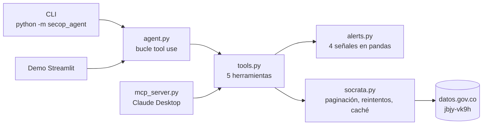

<!--
  ### Archivo: README.md ###
  Autor: Juan Camilo Agudelo (Jagudelo14)
  Correo: camiloagu1401@gmail.com
  Fecha: 2026-11-16
  Descripción: Presentación, instalación y métricas del agente SECOP II
-->

# Agente analista de contratación pública (SECOP II)

Un agente en Python que responde preguntas en lenguaje natural sobre contratos públicos colombianos y marca patrones que vale la pena revisar. Cada cifra que entrega trae el enlace al contrato del que salió.

> *¿Qué contratistas recibieron más dinero por contratación directa de la Secretaría General de la Alcaldía Mayor de Bogotá en 2025?*
> → tabla con el top, total en pesos, número de contratos y enlace a SECOP de cada uno.

Qué muestra este repo:

1. **Un agente con herramientas sobre una API real con datos sucios.** El bucle de *tool use* está escrito a mano con el SDK `anthropic`, sin LangChain ([agent.py](src/secop_agent/agent.py)).
2. **Un servidor MCP propio** que expone las mismas herramientas ([mcp_server.py](src/secop_agent/mcp_server.py)).
3. **Calidad medida** con un set de 30 preguntas cuyas respuestas correctas se recalculan en vivo ([evals/](evals/)).
4. **Se corre en cinco minutos.**

## Arranque en cinco minutos

```bash
pip install uv
git clone <repo> && cd secop-agent
uv sync --extra demo
cp .env.example .env        # pon tu ANTHROPIC_API_KEY (y si quieres SOCRATA_APP_TOKEN)

uv run python -m secop_agent "¿Cuántos contratos firmó la Gobernación del Cauca en 2025?" --traza
uv run streamlit run app/streamlit_app.py
uv run pytest
```

## Arquitectura



Claude solo decide qué consultar y redacta la respuesta. Los montos, rankings y alertas los calcula el código, y `tools.py` es la única fuente de herramientas: el agente y el MCP importan las mismas funciones y las mismas descripciones.

| Herramienta | Qué hace |
| --- | --- |
| `buscar_entidad(nombre)` | Candidatas con `codigo_entidad` y NIT, sin importar tildes |
| `consultar_contratos(filtros)` | Lista contratos (máximo 5.000) con el conteo y la suma reales |
| `agregar(filtros, agrupar_por, metrica)` | Rankings y totales agrupados en el servidor con `$group` |
| `detectar_alertas(codigo_entidad, anio)` | Las 4 señales con los contratos que las generan |
| `detalle_contrato(id_contrato)` | Un contrato con su enlace a SECOP |

## Lo que salió del esquema real (fase 0)

`scripts/fase0_esquema.py` baja los metadatos y 1.000 filas y genera [docs/schema.json](docs/schema.json) y [docs/esquema.md](docs/esquema.md). Todas las columnas esperadas existen. Lo que cambió el diseño:

- **El NIT no identifica una entidad.** Las secretarías de Bogotá comparten el NIT del Distrito, y el mismo NIT aparece con y sin dígito de verificación (`899999061` y `8999990619`). Se filtra y agrupa por `codigo_entidad`.
- `urlproceso` llega como objeto `{"url": ...}`, no como texto.
- Los montos son `number` en Socrata (se suman en el servidor) pero llegan como texto en el JSON.
- Hay contratos sin `fecha_de_firma`; ordenar por fecha `DESC` los pone primero.
- Comparar con comodines para ignorar tildes mezcla lugares ("Cauca" atrapaba "Chocó"). Departamentos y ciudades se resuelven contra la lista real de valores y se filtran con `=`.
- `tipo_de_contrato` y `modalidad_de_contratacion` son listas cerradas y se validan como `enum`.

## Señales de alerta

Cuatro reglas deterministas en pandas ([alerts.py](src/secop_agent/alerts.py)). El LLM nunca decide si algo es una alerta, solo explica las que el código encontró. Cada hallazgo sale con el aviso *"patrón para revisar, no implica irregularidad"* y los enlaces a sus contratos.

| Señal | Regla | Parámetros |
| --- | --- | --- |
| Posible fraccionamiento | Misma entidad y proveedor, 3+ contratos en la ventana, cada uno bajo el umbral y la suma por encima | `ventana_dias=30`, `umbral_fraccionamiento=50.000.000` |
| Concentración en contratación directa | Un proveedor recibe más del porcentaje del valor directo de la entidad en el año | `porcentaje_concentracion=0.20`, `monto_minimo_entidad=100.000.000` |
| Fechas inconsistentes | Fin antes del inicio, firma después del inicio o duración cero | — |
| Valor atípico | Valor sobre el percentil del mismo tipo y modalidad en la entidad | `percentil_atipico=99`, `min_grupo_atipico=20` |

## Evaluación

30 preguntas en [evals/preguntas.jsonl](evals/preguntas.jsonl), cada una con su consulta SoQL escrita a mano. Las respuestas correctas se recalculan en cada corrida porque SECOP cambia todos los días.

| Tipo | Cantidad | Cómo se califica |
| --- | --- | --- |
| Conteo o suma | 10 | Cifra exacta o diferencia menor al 1 % |
| Ranking | 8 | Los 5 primeros coinciden en orden |
| Filtro con varias condiciones | 8 | Mismo conjunto de `id_contrato` |
| Fuera de alcance o ambigua | 4 | Pide aclaración o declina, sin inventar cifras |

```bash
uv run python evals/run.py --validar          # revisa las 30 consultas, sin gastar LLM
uv run python evals/run.py --limite 5         # fase 3: las 5 primeras
uv run python evals/run.py                    # set completo, reporte en evals/resultados/ultimo.md
uv run python evals/run.py --modelo claude-haiku-5-5
```

**Resultados:** pendiente de la primera corrida. Meta de la v1: 24/30. Pegar aquí la tabla de `evals/resultados/ultimo.md` (acierto, tokens, costo en USD, latencia y llamadas a herramientas por pregunta).

## Servidor MCP en Claude Desktop

En `claude_desktop_config.json`:

```json
{
  "mcpServers": {
    "secop-ii": {
      "command": "uv",
      "args": ["--directory", "C:/ruta/a/secop-agent", "run", "secop-mcp"]
    }
  }
}
```

## Modelos y costo

Claude Sonnet 5.5 por defecto y Claude Haiku 5.5 como opción barata, elegidos con la variable `MODEL`. Con Sonnet se activa el *fallback* del servidor (`fallbacks: "default"`) por si el modelo rechaza una petición. El prompt de sistema y las herramientas van en caché. Máximo 8 llamadas a herramientas por pregunta.

## Demo pública

La demo de Streamlit usa Haiku con un límite de 5 preguntas por sesión, o Sonnet sin límite si el visitante pega su propia llave. Oculta la cédula de las personas naturales. Para Streamlit Community Cloud se usa `requirements.txt` y la llave va en los *secrets* como `ANTHROPIC_API_KEY`. Si datos.gov.co está caído, `SECOP_MODO_DEMO=1` responde solo desde la caché en disco.

## Estructura

```
secop-agent/
├── src/secop_agent/
│   ├── socrata.py        # cliente API: paginación, reintentos, caché
│   ├── schema.py         # columnas reales, normalización, validación, SoQL
│   ├── tools.py          # herramientas que ven el agente y el MCP
│   ├── alerts.py         # las 4 señales, sin LLM
│   ├── agent.py          # bucle del agente con tool use
│   ├── mcp_server.py     # mismas herramientas por MCP
│   └── __main__.py       # CLI
├── app/streamlit_app.py
├── scripts/fase0_esquema.py
├── evals/preguntas.jsonl
├── evals/run.py
├── tests/                # sin red, con respuestas grabadas
└── docs/schema.json
```

## Datos

[SECOP II – Contratos Electrónicos](https://www.datos.gov.co/d/jbjy-vk9h), Colombia Compra Eficiente, licencia CC BY-SA 4.0.
